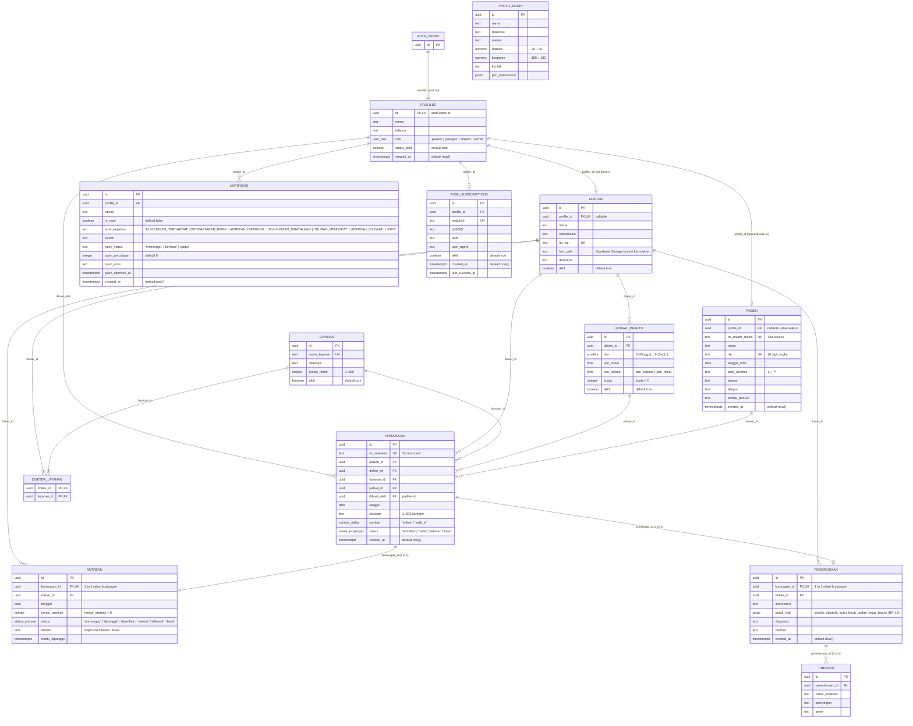

# Diagram Hubungan Entitas (Entity-Relationship Diagram - ERD)
**Sistem Informasi Klinik Kesehatan (Klinik Tim 7)**  
*Diekstrak langsung dan divalidasi 100% terhadap `src/db/schema.ts` dan migrasi PostgreSQL*

---

## 1. Diagram Mermaid ERD

---

## 2. Rincian Batasan & Indeks Penting Database (Lapisan Ketiga)

| Tabel | Tipe Batasan / Indeks | Definisi & Tujuan |
|---|---|---|
| `pasien` | `CHECK (pasien_nik_check)` | `nik ~ '^[0-9]{16}$'` (Wajib persis 16 digit angka, K10) |
| `pasien` | `UNIQUE INDEX (uq_pasien_nik)` | NIK tidak boleh terdaftar ganda di database |
| `dokter` | `UNIQUE (dokter_no_sip_key)` | Nomor Surat Izin Praktik dokter wajib unik |
| `layanan` | `CHECK (layanan_durasi_menit_check)` | Durasi konsultasi antara 1 sampai 480 menit |
| `jadwal_praktik` | `CHECK (ck_jadwal_jam)` | `jam_selesai > jam_mulai` |
| `jadwal_praktik` | `CHECK (jadwal_praktik_kuota_check)` | `kuota > 0` |
| `kunjungan` | `UNIQUE PARTIAL INDEX (uq_kunjungan_aktif)` | `(pasien_id, jadwal_id, tanggal) WHERE status <> 'batal'` (Anti pendaftaran ganda pada jadwal & tanggal sama, BR-02) |
| `antrean` | `UNIQUE (uq_antrean_nomor)` | `(dokter_id, tanggal, nomor_antrean)` (Nomor antrean unik per dokter per tanggal, BR-03) |
| `antrean` | `CHECK (ck_antrean_alasan)` | Status `dilewati` dan `batal` wajib memiliki alasan (BR-15) |
| `pemeriksaan` | `CHECK (pemeriksaan_tanda_vital_check)` | Fungsi `fn_valid_tanda_vital(tanda_vital)` memvalidasi batas fisiologis (sistolik 50–300, diastolik 30–200, suhu 30–45, berat_badan 1–500, tinggi_badan 20–250, BR-18) |
| `notifikasi` | `INDEX (idx_notifikasi_push)` | Indeks komposit `(push_status, created_at)` untuk efisiensi polling outbox background worker BullMQ |
